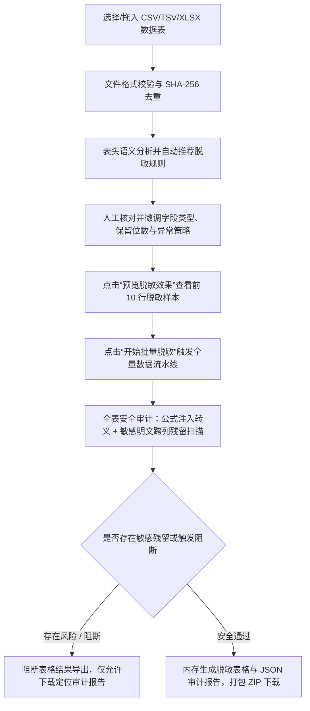

# 面向学生信息表的批量脱敏与安全导出工具设计与实现

面向高校与教育管理场景中学生信息表流转、汇总及外发时的隐私保护需求，设计并实现了一套**纯本地离线运行、轻量安全、开箱即用**的表格批量脱敏与合规导出工具。

系统支持 CSV、TSV 与 Excel (.xlsx) 多源表格格式解析，具备列级敏感字段智能推断、动态可调星号掩码脱敏、多级异常数据隔离策略、导出前敏感残留深度审计、CSV/Excel 宏公式注入转义防御以及零泄露合规审计报告生成等核心能力。

---

## 一、系统核心特性

- **纯本地离线隐私沙箱**：基于 WebAssembly (Pyodide) 纯前端沙箱执行 Python 脱敏算法，数据完全保存在宿主内存中，无任何服务端数据库存储或网络外发，杜绝隐私泄露风险。
- **多格式流式表格解析**：支持 CSV、TSV 及 Excel (.xlsx) 格式，自动探测 UTF-8-SIG 与 GB18030 中文字符集，长整型标识符（如学号、身份证号）严格按文本解析，防止浮点失真。
- **表头语义智能推断**：内置常见中英文别名字典知识库，导入即自动推断手机号、身份证、邮箱、姓名、学号等类别并匹配推荐脱敏策略；同名列在批次内智能联动。
- **动态保留掩码脱敏**：
  - **手机号**：归一化提取并统一规范化输出 `+86`，默认保留前 3 后 4 位掩码遮盖；
  - **身份证号**：严格按照 GB 11643-1999 校验 18 位结构、出生日期真实性及 ISO 7064:1983.MOD 11-2 加权校验位，默认保留前 3 后 2 位；
  - **姓名/学号/邮箱**：支持动态前后缀保留位数配置，实施单字姓名/短文本防全泄露安全切片，邮箱支持域名选择性屏蔽。
- **多级异常分流策略**：
  - **异常值占位隐藏**：格式非法或缺失项替换为占位符，其余字段正常脱敏导出；
  - **整行隔离跳过**：异常数据行整体剔除，隔离污染；
  - **熔断阻断导出**：检出任何数据异常或敏感残留时即刻阻断表格导出，仅输出去名化定位审计报告。
- **导出前深度安全审计**：扫描全部导出行及动态表头，结合通用敏感正则与本批次已收集明文字典实施跨列跨表全量排查，阻断隐蔽残留。
- **公式注入转义防护**：自动识别以 `=, +, -, @` 开头的潜在计算式文本并注入单引号前缀，彻底防御 CSV/Excel 宏执行注入风险。
- **双端运行与原生交互**：同一套前端逻辑无缝支持现代浏览器直接访问以及基于 Edge WebView2 的轻量级原生 Windows 桌面程序。

---

## 二、快速启动

### 方式 A：Windows 便携桌面程序（推荐）

在 [Releases](https://github.com/jie322/student-data-masking-tool/releases) 下载 **`学生信息脱敏工具.exe`**，双击即可启动。本机原有交付目录中的程序位于源码目录的上一级。
- 基于系统内置 Microsoft Edge WebView2 运行时渲染，**本机无需预装 Python 环境**。
- 窗口关闭后，后台本地辅助服务自动释放退出。
- 附带的 EXE 为原有桌面构建；当前仓库包含后续模块化源码。需要生成与当前源码对应的程序时，按[开发与打包](docs/开发与打包.md)构建。

### 方式 B：本地 Web 服务浏览器运行

在工程根目录启动本地轻量 HTTP 服务：

```powershell
python run_local.py
# 或直接双击根目录下的“启动工具.cmd”
```

服务就绪后，在现代浏览器中访问：**`http://127.0.0.1:8000/index.html`**。
*(注：处理引擎依赖 Pyodide 与 Web Worker 运行，直接双击 HTML 文件会受跨域安全限制，请通过本地服务访问。)*

---

## 三、操作业务流程



1. **导入表格**：选取一个或多个表格文件，或点击“导入学生信息表”载入内置的 100 行标准测试数据集。
2. **核对与配置**：检查系统推荐的列类型，根据实际需求调整保留位数、必填开关及异常策略（隐藏/跳过/阻断）。
3. **样本前瞻预览**：点击“预览脱敏效果”，快速核验各表前 10 行的处理样式，验证脱敏模式是否符合合规预期。
4. **全量批量脱敏**：确认无误后点击“开始批量脱敏”，系统将对全部数据执行流式脱敏与全表深度安全扫描。
5. **安全导出落盘**：审计通过后下载包含规范脱敏表格与 `处理报告.json` 的压缩包（桌面端弹出原生文件选择器保存）。

---

## 四、项目工程结构与源码导航

```text
project8/
├─ index.html                    页面结构：导入管理、规则网格、看板统计、预览与审计面板
├─ css/main.css                  页面视觉：现代深色/浅色响应式主题与数据表格样式
├─ js/
│  ├─ main.js                    前端应用交互主入口，负责生命周期编排与事件注册
│  ├─ state.js                   内存级全局响应式状态上下文（文件队列、规则映射、引擎就绪态）
│  ├─ config.js                  界面词汇表与元数据枚举配置（字段类型、操作模式、统计标签）
│  ├─ theme.js                   主题偏好管理与防闪烁加载控制
│  ├─ features/
│  │  ├─ import.js               文件导入校验、SHA-256 内容去重与元数据解析
│  │  └─ processing.js           脱敏流水线编排（前瞻预览、全量批处理、熔断判断与 ZIP 压缩）
│  ├─ ui/
│  │  ├─ dom.js                  DOM 操作工具与纯文本防 XSS 表格生成器
│  │  ├─ feedback.js             交互状态同步器（运行日志、通告提示、组件忙碌态锁定）
│  │  ├─ files.js                导入文件卡片与前置源表样本渲染
│  │  ├─ rules.js                规则配置网格渲染与动态输入控制
│  │  └─ results.js              看板指标、折叠预览面板与结构化审计问题视图
│  ├─ services/
│  │  ├─ engine.js               Web Worker 客户端通信服务（异步 RPC 协议与 Promise 映射）
│  │  ├─ report.js               零敏感泄露合规审计报告组装服务
│  │  └─ downloads.js            跨平台导出通道服务（Blob URL 管理与桌面 IPC 保存桥接）
│  ├─ worker.js                  Web Worker 计算沙箱主入口与任务分发路由
│  └─ worker/
│     ├─ runtime.js              Pyodide WebAssembly 运行时加载与虚拟文件系统挂载
│     ├─ network.js              沙箱网络安全守卫（限制外部通信）
│     ├─ student-handler.js      学生脱敏任务适配处理器（MEMFS 挂载与零拷贝流转移）
│     ├─ errors.js               异常信息安全脱敏清洗
│     └─ legacy-handlers.js      兼容性旧版通用脱敏接口处理器
├─ py/
│  ├─ student.py                 顶级脱敏引擎外观入口 (Facade)
│  └─ student_tool/
│     ├─ __init__.py             核心处理算法与工具函数导出清单
│     ├─ constants.py            系统常量、枚举契约、安全正则与语义别名字典
│     ├─ rules.py                列规则推断与合规性严格校验
│     ├─ readers.py              多源表格流式解析与字符编码自适应探测
│     ├─ masking.py              单元格格式合规校验、幂等检测与动态掩码生成
│     ├─ processor.py            批处理流水线编排、多级异常策略分流与全流程管理
│     ├─ safety.py               CSV 公式注入转义防护与敏感明文全量残留审计
│     └─ exporters.py            全新纯净工作簿流式构建与 UTF-8 BOM 持久化写出
├─ desktop.py                    Windows 桌面原生应用启动入口
├─ desktop_app/                  桌面视窗支持包（生命周期、本地 HTTP 静态服务与 IPC 桥接）
├─ run_local.py                  本地 Web 独立启动服务脚本
├─ sample_data/                  标准学生数据集、异常边界样本集与人工核对清单
├─ public_data/                  真实公开联系方式样本及脱敏处理验证配置
├─ tests/                        自动化集成与单元测试套件（覆盖 170 项测试）
├─ docs/                         系统设计、架构、开发与测试文档
└─ vendor/                       Pyodide 核心、openpyxl Wheel 包与 JSZip 离线库
```

---

## 五、技术文档清单

| 文档名称 | 主要说明与阅读指引 |
| --- | --- |
| [项目交接文档](docs/项目交接文档.md) | 系统开发基准、运行方式、模块边界、交付物清单及后续维护约定 |
| [使用说明](docs/使用说明.md) | 完整操作指南、字段合规规范、掩码算法口径、异常策略与常见排错 |
| [代码架构说明](docs/代码架构说明.md) | 模块职责划分、系统分层架构、数据流向图解与核心扩展点说明 |
| [源码阅读入门](docs/源码阅读入门.md) | 架构设计理念、设计模式应用、核心数据结构与关键代码调用链 |
| [开发与打包](docs/开发与打包.md) | 开发环境构建、自动化测试执行、代码规范校验与便携式打包指南 |
| [测试报告](docs/测试报告.md) | 自动化测试验证记录、性能基准、边界测试用例与审计覆盖率说明 |
| [学生信息表说明](sample_data/使用说明.md) | 100 行基准数据、12 行边界异常表设计口径与人工核对清单 |
| [公开数据说明](public_data/数据来源与使用说明.md) | 真实公开数据集来源、中文导入表与脱敏配置实践 |

---

## 六、验证与测试质量报告

- **Python 测试套件**：全量 170 项 pytest 行为与边界测试全部通过（包含单元测试、集成流程测试及异常注入测试）。
- **JavaScript 语法校验**：ES 模块全量文件通过 Node.js 静态语法合规检查。
- **脱敏业务基准测试**：针对 100 行标准学生表（CSV 与 XLSX 格式）执行全量批处理，共处理 200 行记录、1800 个敏感单元格，全表敏感残留率为 0，符合安全导出标准。
- **异常拦截能力**：针对 12 行边界异常测试用例，成功对畸形身份证、非法电话、缺失学号、行宽不一致等场景实施精确识别与分流隔离。

---

## 七、第三方组件与许可证

本项目基于 [Alvsok/anonymizer](https://github.com/Alvsok/anonymizer) 二次开发，采用 Apache-2.0 许可证，完整条款见 [LICENSE](LICENSE)。第三方组件（Pyodide、openpyxl、JSZip、pywebview 等）的来源与许可见 [THIRD_PARTY_NOTICES.md](THIRD_PARTY_NOTICES.md)。公开数据按各自的许可使用。
