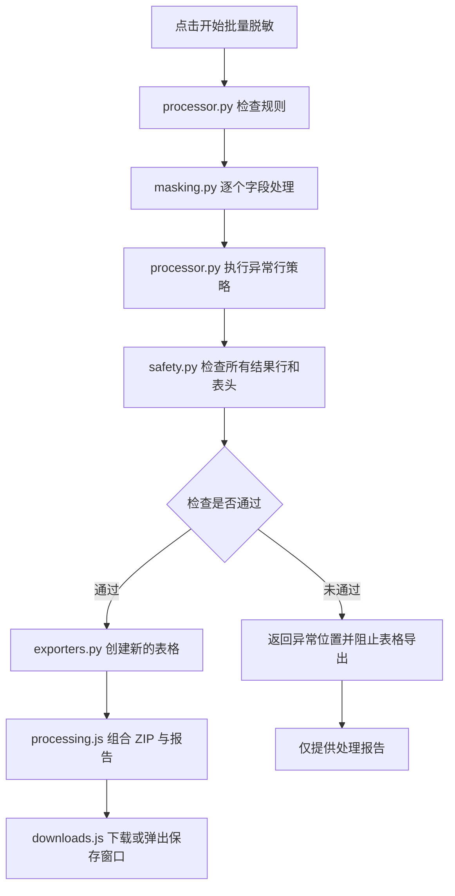

# 代码架构说明

系统使用、字段规则和异常策略见 [使用说明](使用说明.md)，环境与构建方法见 [开发与打包](开发与打包.md)。常见代码写法见 [源码阅读入门](源码阅读入门.md)。

## 一、总体结构

系统按五项职责组织：页面显示、页面操作流程、后台引擎、表格处理和桌面运行。

| 模块 | 职责 | 主要目录 |
| --- | --- | --- |
| 页面 | 显示文件、规则、预览、异常和下载按钮 | `index.html`、`css/`、`js/ui/` |
| 页面操作流程 | 组织导入、预览和处理流程 | `js/features/` |
| 后台引擎 | 在页面之外执行较耗时的任务，连接 JavaScript 和 Python | `js/worker/` |
| 表格处理 | 读取表格、推荐规则、遮盖字段、处理异常、检查残留、写出新表格 | `py/student_tool/` |
| 桌面运行 | 启动本地资源服务、打开程序窗口、弹出保存对话框 | `desktop_app/` |

后台任务由浏览器 Worker 在本机执行。`run_local.py` 提供 HTML、脚本和依赖文件，不接收上传的学生表格。表格内容通过页面内存传入 Worker 的临时文件系统。

## 二、主要入口

| 入口 | 职责 |
| --- | --- |
| `index.html` | 定义页面区域、按钮及元素编号 |
| `js/main.js` | 绑定页面事件，调用导入与处理流程 |
| `js/features/` | 组织导入、样本预览和完整处理 |
| `js/services/engine.js` | 管理请求编号和后台通信 |
| `js/worker/student-handler.js` | 调用 Python 学生表格处理接口 |
| `py/student_tool/processor.py` | 组织行处理、残留检查和导出 |
| `desktop.py` | 启动桌面窗口及本地资源服务 |

第三方运行库保存在 `vendor/`，业务实现位于 `js/`、`py/` 和 `desktop_app/`。

## 三、目录对应的职责

```text
project8/
├─ index.html                    页面结构：导入、规则、结果、日志
├─ css/main.css                  页面布局及明暗主题样式
├─ js/
│  ├─ main.js                    页面入口：绑定按钮、启动引擎
│  ├─ state.js                   当前导入文件、列规则、就绪/忙碌状态
│  ├─ config.js                  页面共用的中文字段名、处理方式、统计名称
│  ├─ theme.js                   明暗主题切换与偏好记忆
│  ├─ features/
│  │  ├─ import.js               格式检查、内容去重、导入和示例文件读取
│  │  └─ processing.js           样本预览、完整批处理、汇总和结果包生成
│  ├─ ui/
│  │  ├─ dom.js                  创建元素和表格的基础函数
│  │  ├─ feedback.js             按钮状态、提示、日志、旧结果清理
│  │  ├─ files.js                文件列表、移除文件和原始样本
│  │  ├─ rules.js                字段规则表的显示和修改
│  │  └─ results.js              脱敏结果、统计、异常位置的显示
│  ├─ services/
│  │  ├─ engine.js               请求编号及 Worker 消息收发
│  │  ├─ report.js               不含敏感原文的中文处理报告
│  │  └─ downloads.js            下载地址管理及桌面保存接口调用
│  ├─ worker.js                  后台入口：初始化和任务分发
│  └─ worker/
│     ├─ runtime.js              加载 Pyodide、Excel 组件和 Python 源码
│     ├─ network.js              限制 Worker 的资源访问范围
│     ├─ student-handler.js      学生表格的读取、预览、处理请求
│     ├─ errors.js               Python 报错文本的截取函数
│     └─ legacy-handlers.js      原有通用匿名化接口，供旧代码兼容
├─ py/
│  ├─ student.py                 统一导入入口，转接到下方处理模块
│  └─ student_tool/
│     ├─ __init__.py             常用处理函数的导出入口
│     ├─ constants.py            字段别名、支持的类型、固定原因、格式表达式
│     ├─ rules.py                列名推荐和配置合法性检查
│     ├─ readers.py              CSV/TSV/Excel 读取、原始样本生成
│     ├─ masking.py              单元格校验、规范化、星号遮盖
│     ├─ processor.py            行处理、异常策略、完整流程组织
│     ├─ safety.py               公式文本转义和敏感原文残留检查
│     └─ exporters.py            新建并写出脱敏表格
├─ desktop.py                    Windows 桌面程序入口
├─ desktop_app/
│  ├─ __init__.py               桌面支持包入口
│  ├─ application.py            窗口及资源服务的启动和退出
│  ├─ bridge.py                 主题偏好与保存对话框接口
│  └─ server.py                 浏览器和桌面共用的本地资源服务
├─ run_local.py                  浏览器方式的启动入口
├─ build_desktop.py              收集资源并打包 EXE
├─ desktop_verify.py             桌面实际操作检查
├─ sw.js                         本地资源的离线缓存
├─ sample_data/                  学生表格、异常表格、核对样本和处理脚本
├─ public_data/                  公开原件、中文导入表、处理结果和整理脚本
├─ tests/                        自动化行为测试
├─ docs/                         架构与测试说明
├─ output/                       测试记录和截图
└─ vendor/                       Pyodide、openpyxl 安装包和 JSZip
```

`py/config.py`、`engine.py`、`heuristics.py`、`links.py`、`mapping.py`、`masker.py`、`restorer.py`、`report.py` 是保留的通用匿名化代码，原测试继续覆盖它们。它们包含旧的映射和恢复能力，**当前学生页面没有这些操作入口**。学生表格的规则和处理算法应从 `student_tool/` 查找，避免与旧的通用接口混淆。

## 四、数据处理流程

### 1. 导入表格


页面读取文件副本，并按文件内容计算摘要，避免重复导入。Python 返回列名、前 5 行原始样本、行数和推荐规则。文件本身不被修改。

### 2. 预览脱敏效果

点击“预览脱敏效果”后，`processing.js` 发送 `student-preview` 消息。`student-handler.js` 调用 `preview_file()`，每张表只取前 10 行，按当前规则执行处理与样本检查。`results.js` 将结果展开显示；此时不生成导出文件。

### 3. 完整处理与导出



样本检查通过只说明样本可以处理。完整处理仍重新读取原始文件，检查整表，不能用预览结果直接代替导出。

## 五、字段识别

字段推荐由 `rules.py` 的 `recommend(column)` 实现，别名清单在 `constants.py` 的 `ALIASES` 中。

例如，列名“手机号”“手机号码”“联系电话”都对应 `phone`。程序先去除列名两端空白、转小写、去掉普通空格，再与别名逐项匹配。推荐依据是表头别名，普通列仍需人工核对。未匹配的列推荐为 `other`，默认保留，由使用者核对后手动调整。同名列在同一批次中共用一条规则。

一条规则的数据形式如下：

```json
{
  "type": "phone",
  "mode": "mask",
  "prefix": 3,
  "suffix": 4,
  "keep_domain": false,
  "required": false
}
```

含义依次为：字段类型、处理方式、保留前几位、保留后几位、是否保留邮箱域名、是否必填。界面显示名称来自 `js/config.js`；真正的合法性检查在 Python 的 `rules.py` 中完成。

## 六、功能与代码对应关系

| 功能项 | 主要修改位置 | 同时需要关注 |
| --- | --- | --- |
| 让“家长手机”等新列名自动识别 | `py/student_tool/constants.py` 的 `ALIASES` | `tests/test_student.py` 的列名推荐测试 |
| 调整默认遮盖位数 | `py/student_tool/rules.py` 的 `recommend()` | `js/ui/rules.js` 中手动切换字段类型时的默认位数 |
| 修改手机号、邮箱、身份证的校验或遮盖 | `py/student_tool/masking.py` | 格式、短值、已脱敏值和重复处理测试 |
| 修改异常行的处理方式 | `py/student_tool/processor.py` | mask / skip / stop 三种策略及列数错位 |
| 修改敏感残留或公式转义检查 | `py/student_tool/safety.py` | 表头、其他列、预览之外的数据行也要检查 |
| 修改页面的中文选项 | `js/config.js`、`index.html` | 如果新增字段类型，也要修改 Python 类型和校验逻辑 |
| 修改预览的显示方式 | `js/ui/results.js` | 样本预览和正式结果使用不同提示 |
| 修改报告中的统计与字段 | `js/services/report.js` | 不写原始文件名、敏感列名及单元格原文 |
| 修改导出表格格式 | `py/student_tool/exporters.py` | 必须经过 processor 的残留检查后调用 |
| 修改窗口大小或标题 | `desktop_app/application.py` | 页面标题另见 `index.html` |
| 修改导出保存对话框 | `desktop_app/bridge.py` | `js/services/downloads.js` 负责调用 |
| 新增 Python 或 JavaScript 文件 | 对应功能目录 | Python 源码需登记在 `js/worker/runtime.js`，应用资源需登记在 `sw.js` |

## 七、运行与维护

浏览器入口为 `run_local.py`，桌面入口为 `desktop.py`，构建入口为 `build_desktop.py`。安装、测试及构建命令统一见 [开发与打包](开发与打包.md)，当前验证结果见 [测试报告](测试报告.md)。

新增模块时，需要同步检查后台源码清单和缓存资源清单。当前结构的学生处理接口保留在 `py/student.py`，调用方无需直接依赖各内部文件。
