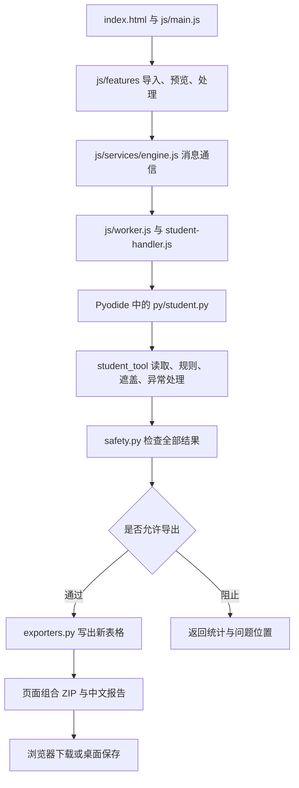

# 项目交接文档

交接日期：2026 年 11 月 9 日

项目名称：面向学生信息表的批量脱敏与安全导出工具设计与实现

## 一、项目用途与当前状态

项目面向需要转交、汇总学生信息表的使用场景。使用者导入表格，按列确认处理规则，查看脱敏样式，再处理全部记录并另存结果。系统支持 CSV、TSV 和 XLSX，提供中文页面和 Windows 独立窗口。

学生表格处理、中文界面、处理前预览、明暗主题、模块拆分和源码注释已完成。导入、批量处理、残留拦截和桌面保存已有验证记录。已脱敏标识的重复判断仍有缺陷，现有 EXE 也尚未包含最新模块化源码。接手时应先区分已实现功能、既有检查记录和待修正事项。

当前交接只整理文档及入口，没有修改业务代码、重建数据或重新打包程序。

## 二、目录与文件基准

| 位置 | 内容与使用方式 |
| --- | --- |
| `E:\毕业设计3\project8` | 当前项目源码，后续代码修改在此进行 |
| `E:\毕业设计3\学生信息脱敏工具.exe` | 已有桌面程序，约 20 MB；早于当前源码 |
| `E:\毕业设计3\学生信息表` | 交付用学生表及相关副本 |
| `project8/sample_data/` | 内置学生表、异常表、生成脚本和人工核对清单 |
| `project8/public_data/` | 公开下载件、来源记录、中文导入表及处理结果 |
| `project8/output/` | 测试记录、结果包和界面截图 |
| `E:\毕业设计3\论文` | 论文、开题报告及历史修订版本 |
| `E:\毕业设计\论文初稿\毕业设计参考` | 学校模板及格式参考 |

本机路径用于定位现有交付文件；文档内部的相对路径均从项目根目录计算。迁移机器时，应先修改命令中的根目录。

当前论文编辑基准为：

`E:\毕业设计3\论文\毕业论文_面向学生信息表的批量脱敏与安全导出工具设计与实现_开发实践修订稿.docx`

该文件共 22 页，包含开发环境与技术准备、核心实现、界面展示和实验分析。六幅核心代码图为实际 VS Code 截图，保留中文注释、行号及完整源码路径，另保留五幅界面图。目录页码与当前分页已核对。其他同题论文属于较早版本，不应仅凭文件名相近就覆盖当前修订稿。

与当前论文直接相关的工作记录保存在项目同级的两个目录中：

- `.student_thesis_implementation_20261109/`：实现核对、实验记录及前次论文编辑材料。
- `.student_thesis_vscode_20261109/`：实际源码截图、论文修改前备份及最终排版检查记录。

这些目录是工作记录，不属于程序运行资源。其中旧论文生成脚本不应直接用于重建当前论文，否则会覆盖后续人工修改和最新截图。

## 三、先运行起来

### 1. 浏览器运行

在 PowerShell 中执行：

```powershell
Set-Location -LiteralPath 'E:\毕业设计3\project8'
python run_local.py
```

访问 <http://127.0.0.1:8000/index.html>，等待“引擎已就绪”。也可双击项目根目录的 `启动工具.cmd`。浏览器入口固定使用 8000 端口，按 Ctrl+C 停止服务。直接双击 HTML 无法正常加载处理引擎。

### 2. 桌面源码运行

```powershell
Set-Location -LiteralPath 'E:\毕业设计3\project8'
.\.venv\Scripts\python.exe desktop.py
```

桌面方式依赖 pywebview 和系统 WebView2，自动选择本机空闲端口，关闭窗口时停止本次资源服务。已有 EXE 可直接运行，无需另装 Python。

### 3. 重建开发环境

项目目前保留 `.venv`。迁移电脑后应重新创建环境：

```powershell
python -m venv .venv
.\.venv\Scripts\python.exe -m pip install -r tests/requirements.txt -r requirements-desktop.txt
```

技术组成包括 Python、HTML、CSS、JavaScript、Pyodide、openpyxl、JSZip、pywebview 和 PyInstaller。具体依赖约束以项目内的 requirements 文件及 `vendor/` 实际资源为准。

## 四、架构与处理流程

系统没有远程业务后端，也不使用数据库。Python 本地服务负责提供页面和依赖资源；选中的学生文件通过浏览器内存传入 Web Worker，由其中的 Pyodide 执行 Python 算法。桌面程序在独立窗口中显示同一套页面，并补充保存对话框。



### 主要文件职责

| 文件或目录 | 职责 |
| --- | --- |
| `index.html`、`css/main.css` | 页面结构、布局及明暗主题样式 |
| `js/main.js`、`js/state.js`、`js/config.js` | 事件入口、当前任务状态、中文选项与统计名称 |
| `js/features/import.js` | 文件检查、内容摘要去重、导入及内置表读取 |
| `js/features/processing.js` | 样本预览、整表处理、批次汇总和 ZIP 生成 |
| `js/ui/` | 文件列表、规则控件、结果、日志和按钮状态 |
| `js/services/` | Worker 通信、处理报告和下载地址管理 |
| `js/worker/runtime.js` | 加载本地运行库并把 Python 源码复制进虚拟文件系统 |
| `js/worker/student-handler.js` | 分发学生表请求，管理临时副本和固定报错提示 |
| `py/student.py` | 对外统一接口，供 Worker、脚本和测试导入 |
| `py/student_tool/constants.py` | 字段类型、表头别名、固定问题原因及格式表达式 |
| `py/student_tool/rules.py` | 表头推荐与规则合法性检查 |
| `py/student_tool/readers.py` | 读取 CSV、TSV、XLSX，返回统一表结构 |
| `py/student_tool/masking.py` | 单元格规范化、格式校验和星号遮盖 |
| `py/student_tool/processor.py` | 行处理、重复判断、异常策略及写出条件 |
| `py/student_tool/safety.py` | 公式文本转义、原文收集与全量残留检查 |
| `py/student_tool/exporters.py` | 新建并写出处理后的表格 |
| `desktop_app/` | 桌面生命周期、资源服务、主题偏好和保存接口 |
| `build_desktop.py` | 收集资源并生成 EXE |
| `sw.js` | 缓存应用资源，与处理学生表的 Worker 分别运行 |

`py/engine.py`、`masker.py`、`mapping.py`、`restorer.py` 等是保留的通用匿名化实现，仍有旧接口和测试依赖。学生页面不提供原文映射、恢复或符号代替入口。修改学生功能应先看 `student_tool/`，不要直接改旧引擎代替当前处理流程。

## 五、接口与功能约定

### 1. 消息与 Python 入口

| 页面消息 | Python 入口 | 返回内容 |
| --- | --- | --- |
| `student-inspect` | `inspect_file(source)` | 表头、前 5 行原始样本、行数和推荐规则 |
| `student-preview` | `preview_file(source, rules, policy)` | 各表前 10 行的处理统计和脱敏样本，不生成导出文件 |
| `student-process` | `process_file(source, destination, rules, policy)` | 完整处理统计、问题位置、样本及阻止状态；通过时另返回文件字节 |

Worker 用请求编号关联消息，统一返回 `student-result`。临时文件位于浏览器虚拟文件系统，处理结束在 `finally` 中清理，不覆盖磁盘原文件。

`read_tables()` 返回多个数据表，每张表的结构为 `{"columns": [...], "rows": [[...], ...]}`。处理结果包含 `summary`、`issues`、`sheets` 和 `blocked`。`issues` 使用表编号、原始行列位置、问题代码和固定原因，不附单元格原文。

`summary` 的主要计数为 `input_rows`、`output_rows`、`anomaly_rows`、`skipped_rows`、`masked_cells`、`residual_cells` 和 `formula_cells`。其中 `output_rows` 是候选结果行数；`blocked=true` 时不能把该计数解释为已经写出文件。

### 2. 字段规则

规则以列名为键，同批次同名列共用配置。例如手机号默认规则为：

```json
{
  "type": "phone",
  "mode": "mask",
  "prefix": 3,
  "suffix": 4,
  "keep_domain": false,
  "required": false
}
```

字段类型为手机号、邮箱、身份证号、姓名、学号／身份标识、地址、敏感文本、普通字段。处理方式只保留 `keep`、`mask`、`full`、`drop`，对应保留原值、部分遮盖、全部隐藏、删除列。

自动推荐通过 `constants.py` 的 `ALIASES` 匹配表头，不读取整列内容推断语义。未匹配的列按普通字段保留，需要手动核对。“身份标识”这一表头当前对应身份证类型，实际存放学号时应手动调整。

### 3. 已确定的行为

- 支持 `.csv`、`.tsv`、`.xlsx`；旧 `.xls` 需另存为 XLSX。单文件上限 25 MB，各表数据合计不超过 10 万行。
- 第一行是表头，不允许空列名或重复列名；Excel 隐藏工作表也参与处理。
- 手机号规范化后按大陆 11 位格式检查，输出统一带 `+86`；部分遮盖默认前 3 后 4。
- 身份证按 18 位结构、出生日期和校验位检查，默认前 3 后 2；不确认真实身份或行政区编码。
- 姓名默认留前 1 位，单字姓名仍需隐藏；学号默认留前 4 位；邮箱默认隐藏域名。
- 原始样本默认收起；处理前预览每表前 10 行并展开，不提供下载；正式结果默认收起，由使用者点击展开。
- 修改规则、异常策略、移除文件或清空任务后，旧预览与下载地址失效。
- 异常策略为 `mask`、`skip`、`stop`。列数错位的行在三种策略下均隔离；任一文件阻止导出时，整批表格 ZIP 均不提供。
- 完整处理的残留检查覆盖全部输出行和表头。原文对照跨同一文件的列与工作表，不建立跨文件身份关联。
- 报告不写源文件名、敏感列名和单元格原文。常规日志只写数量和状态。
- 结果包不含原文件或原文映射。ZIP 为普通压缩包，没有加密或访问控制。

## 六、数据与验证依据

`sample_data/students_100.csv` 和 `students_100.xlsx` 保存相同的 100 行、16 列记录，包含手机号、邮箱、身份证号、学号、姓名等可配置字段，没有备注列。`students_edge_cases.csv` 含 12 行异常数据，另有 12 项人工核对清单。数据维护说明见 [学生信息表说明](../sample_data/使用说明.md)。

`public_data/` 保留公开来源及许可记录。其中学校联系方式适合核对姓名、办公电话、邮箱和地址；部分公开学生表已经匿名化，不含完整姓名、手机号或身份证。不能把这些表默认保留后的结果当作直接身份字段脱敏验证。公开下载件按单文件不超过 20 MB、总量不超过 200 MB 管理，与程序的导入限制分别计算。

### 已有检查记录

以下结果来自 `output/project-review-20261109/` 的既有记录，本次交接没有重新执行全部测试：

| 检查 | 既有结果 |
| --- | --- |
| 全套 Python 测试 | 170 项及 11 项子测试通过，含通用旧接口 |
| 学生工具测试范围 | `tests/test_student.py` 中 33 个测试方法 |
| 正常 CSV 与 XLSX | 共 200 行、1800 个脱敏单元格，未命中残留规则 |
| 异常表，默认策略 | 保留 11 行、异常 8 行、隔离 1 行 |
| 异常表，跳过策略 | 保留 4 行、隔离 8 行 |
| 异常表，停止策略 | 阻止表格导出 |
| 手机号误选保留原值 | 两份正常表检出 200 处残留，阻止导出 |
| 浏览器与桌面流程 | 导入、预览、处理及保存已有通过记录 |

学生字段的单元格重复处理测试已通过，但没有覆盖下一节所列的整表重复标识缺陷。独立人工核对仍待完成；10 万行规模的性能也尚未测量。

### 后续修改时的验证命令

```powershell
Set-Location -LiteralPath 'E:\毕业设计3\project8'
.\.venv\Scripts\python.exe -m unittest discover -s tests -p test_student.py -v
.\.venv\Scripts\python.exe -m pytest tests -q
```

桌面修改可执行自检，读取输出 JSON 的“检查状态”：

```powershell
.\.venv\Scripts\python.exe desktop.py --self-test 'E:\毕业设计3\project8\output\desktop\交接后源码检查.json'
```

该命令使用隐藏窗口，会写入检查记录及结果包。自检通过正式保存接口保存到固定位置，没有代替人工点击系统文件对话框。不要覆盖旧记录后仍引用旧日期的检查结论。

## 七、待处理事项

### 1. 已遮盖标识被误判为重复

本次交接已用当前源码在内存中复核，未创建新表格。输入为 `sample_data/processed_output/students_100_masked.csv`，按表头重新生成默认规则后执行三种策略：

| 策略 | 候选保留行数 | 重复提示行数 | 隔离行数 | 是否阻止导出 |
| --- | ---: | ---: | ---: | --- |
| `mask` | 100 | 99 | 0 | 否 |
| `skip` | 1 | 99 | 99 | 否 |
| `stop` | 100 | 99 | 0 | 是 |

原因位于 `py/student_tool/processor.py` 中的 `identifiers` 与 `seen` 比较：不同原始学号遮盖后可能得到相同字符串，该字符串仍被当作可唯一识别学生的标识。字段内容未再次变化，并不能证明记录处置正确。

后续修正应区分原始编号和已遮盖编号，避免用失去唯一性的值直接判断重复。验证至少包括完整正常表的第二次处理、三种异常策略、真实重复原始学号、同表多个标识列，并同时核对行数、问题位置和导出状态。当前论文第 6.3 节及总结已记录该缺陷；修正后应同步修改相应结果和说明。

### 2. EXE 与源码不同步

现有 EXE 的文件时间为 10 月 31 日，当前模块化源码更新于 11 月 9 日。现有程序已有功能自检记录，但该记录不能证明程序内部就是当前源码。后续代码交付需要重新构建并检查实际产物。

### 3. 文档结论尚有适用范围

独立人工结论未填写，不能将自动比较一致写成“人工验证全部通过”。导入上限也不能写成已完成同规模压力测试。残留为 0 表示当前检查规则未命中，不能据此认定未知字段或多列组合信息已消除身份线索。

## 八、修改时需要联动的位置

| 修改任务 | 主要位置 | 同步核对 |
| --- | --- | --- |
| 增加表头别名 | `py/student_tool/constants.py` | 字段推荐测试、使用说明 |
| 调整默认遮盖位数 | `py/student_tool/rules.py` | `js/ui/rules.js` 的切换默认值、核对样本 |
| 新增字段类型 | Python 类型、规则与单元格算法 | `js/config.js`、规则控件、测试和使用说明 |
| 修改行处理或重复判断 | `py/student_tool/processor.py` | 三种策略、报告统计、论文实验结果 |
| 修改残留或公式检查 | `py/student_tool/safety.py` | 表头、跨列、隐藏表、预览之外的记录 |
| 新增 Python 文件 | 对应模块 | `js/worker/runtime.js` 的 `PY_MODULES`、`sw.js` 的 `APP_SHELL` |
| 新增 JavaScript 文件 | 对应功能目录 | 导入路径及 `sw.js` 的资源清单 |
| 增加可返回的固定错误 | Python 校验入口 | `js/worker/student-handler.js` 的允许提示清单 |
| 修改报告或保存流程 | `js/services/`、`desktop_app/bridge.py` | 不含原文、下载失效、实际保存后的文件内容 |
| 更新依赖资源 | `vendor/`、运行库加载清单 | 本地完整加载、缓存策略及许可证记录 |

业务源码缓存优先读取本机服务的新内容，固定第三方依赖优先使用缓存。更新资源清单或依赖时，应核对 `sw.js` 的缓存名称与实际资源；仅刷新页面不一定替换旧依赖。

## 九、重新构建与数据脚本

### 打包程序

```powershell
Set-Location -LiteralPath 'E:\毕业设计3\project8'
python -m venv .build-venv
.\.build-venv\Scripts\python.exe -m pip install -r requirements-desktop.txt
.\.build-venv\Scripts\python.exe build_desktop.py
```

构建会替换上一级目录中的同名 EXE。需要留存旧产物时先另存。打包收集页面、业务源码、`vendor/`、三份内置表和许可文件，不包含公开数据原件、开发环境或已有处理结果。

构建后验证实际 EXE：

```powershell
& '..\学生信息脱敏工具.exe' --self-test 'E:\毕业设计3\project8\output\desktop\交接后EXE检查.json'
```

### 数据维护

以下脚本会覆盖生成文件，运行前先查看脚本和已有人工核对内容：

- `sample_data/generate_students.py`：重建学生表和异常表。
- `sample_data/process_students.py`：重建处理结果与核对清单，可能覆盖已填写结论。
- `public_data/prepare_data.py`：从已保存公开原件整理导入表和结果，不负责网络下载。

只修改说明、截图或论文时，无需运行这些数据脚本。

## 十、写作与维护要求

界面、注释和项目文档以中文为主，说明直接对应功能和实现。避免对话式说明、代写口吻、空泛结论和不必要的精确字节数。论文以开发准备、实现过程和实验结果为主体；软件名称一般不附完整版本号，正文不重新加入已移除的参考文献上下标。

代码图沿用实际 VS Code 截图形式，包含相关中文注释、行号和文件位置。修改截图中的实现后，要核对正文说明和图中代码是否一致，不能只替换文字结论。

项目源自 [Alvsok/anonymizer](https://github.com/Alvsok/anonymizer) 的二次开发。项目来源与第三方组件记录保存在 `THIRD_PARTY_NOTICES.md`，许可证为 `LICENSE`。来源记录与页面展示分别维护，清理项目时保留这些文件。

当前 Git 工作区有大量未提交修改和新增目录，包含实际业务实现、测试及文档。接手后先看 `git status --short`，按本次任务修改相关文件；不要用清空工作区、恢复上游版本或删除全部未跟踪文件的方式整理项目。

## 十一、相关文档

- [使用说明](使用说明.md)：面向使用者的规则、预览、异常策略与导出说明。
- [代码架构说明](代码架构说明.md)：完整目录、函数职责和调用关系。
- [源码阅读入门](源码阅读入门.md)：适合不熟悉代码的阅读顺序与变量说明。
- [开发与打包](开发与打包.md)：运行、依赖、构建与验证命令。
- [测试报告](测试报告.md)：既有检查记录和统计范围。
- [学生信息表说明](../sample_data/使用说明.md)：内置数据及核对清单。
- [公开数据说明](../public_data/数据来源与使用说明.md)：公开资料来源、处理配置及许可。

交接后的修改记录应写明修改文件、执行过的检查、实际结果和仍未解决的问题；源码、程序、截图和论文分别核对，不以其中一项更新推定其他交付件已经同步。
